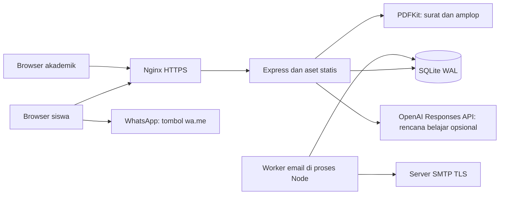
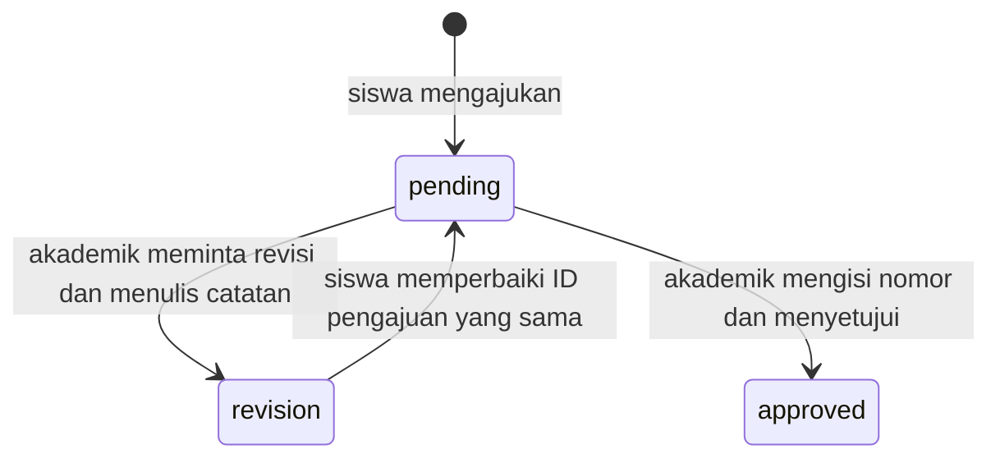
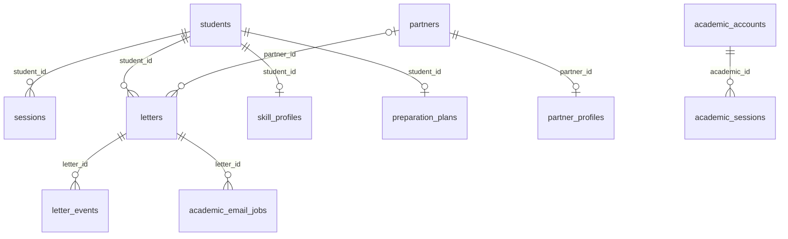

# Project Manager Performance — EduAgentPCT

Dokumentasi knowledge terpadu untuk proyek yang dikonfigurasi pada **https://eduagentpct.my.id/**.

**Pemeriksaan ulang: 2026-10-17.** Dokumen hanya memakai source, konfigurasi, manifest/lockfile, skema hasil migrasi source pada database sementara, riwayat Git, dan evidence tes yang tersedia. Tidak memakai asumsi percakapan untuk menetapkan status produksi.

Snapshot implementasi aplikasi: `b98653a0cf2c17cc20d28780452184d991019556`. HEAD sebelum pemeriksaan ulang: `bf5169c` (perubahan setelah snapshot aplikasi hanya dokumentasi/README). Ini tidak menyatakan VPS sedang memakai commit tersebut.

**Batas nama domain:** permintaan menyebut `eduagent.my.id`, tetapi tautan yang diberikan dan konfigurasi installer menunjuk `eduagentpct.my.id`. Alias `eduagent.my.id` tidak ditemukan pada konfigurasi yang diperiksa.

## Daftar isi

1. [Project Overview](#1-project-overview)
2. [Arsitektur](#2-arsitektur)
3. [Tech Stack](#3-tech-stack)
4. [Struktur Database](#4-struktur-database)
5. [API dan Endpoint](#5-api-dan-endpoint)
6. [User Role & Permission](#6-user-role--permission)
7. [Fitur yang sudah selesai](#7-fitur-yang-sudah-selesai)
8. [Fitur yang belum selesai](#8-fitur-yang-belum-selesai)
9. [Business Rules](#9-business-rules)
10. [Bug dan Technical Debt](#10-bug-dan-technical-debt)
11. [Decision Log](#11-decision-log)
12. [Deployment Notes](#12-deployment-notes)
13. [MOC](#13-moc)
14. [Readme](#14-readme)
15. [Project Manager Performance](#15-project-manager-performance)
16. [Evidence dan batas verifikasi](#16-evidence-dan-batas-verifikasi)

## Panduan status

Implementasi source, hasil tes lokal, konfigurasi yang masih diperlukan, dan kondisi produksi yang belum diverifikasi dibedakan. Tidak ada estimasi persentase selesai, SLA, uptime, kapasitas pengguna, biaya, deadline, atau PIC yang diisi tanpa bukti.

## 1. Project Overview

EduAgentPCT adalah aplikasi web responsif untuk pengajuan surat PKL/TCS siswa PalComTech. Siswa mendaftar pada cabang, memilih tujuan dan peserta, mengajukan pemeriksaan akademik, lalu mengunduh surat/amplop setelah persetujuan dan penerbitan nomor.

### Cakupan yang ditemukan

- Antarmuka siswa pada `/`; antarmuka akademik pada `/academic.html`.
- Tujuh cabang: Palembang Sudirman, Palembang OPI, Palembang Sako, Prabumulih, Lahat, Baturaja, Lubuk Linggau.
- Jenis kegiatan: PKL = Praktik Kerja Lapangan; TCS = Thread Case Study, sesuai literal kode.
- Label rekomendasi: **Cari Rekomendasi Tempat PKL** dan **Rekomendasi Mitra PKL**.
- Profil keahlian, rekomendasi mitra berbobot, rencana belajar template, dan jalur rencana belajar melalui OpenAI.
- Notifikasi WhatsApp manual serta antrean email SMTP otomatis.

### Batas data bawaan

File `scripts/partners-palcomtech.json` berisi **61 mitra Lahat**. File `scripts/career-partners-lahat.json` berisi **5 profil mitra Lahat untuk PKL**. Jumlah file seed ini bukan jumlah baris database produksi.

Identitas kop, pimpinan, email akademik, dan nomor WhatsApp yang dikonfigurasi pada `LETTERHEADS` baru untuk Lahat. Surat cabang tanpa kop dikonfigurasi ditolak saat unduhan. Gambar QR hanya untuk PKL Lahat.

### Produk yang belum ada pada source

Tidak ditemukan klien Flutter, paket Android/iOS/Windows/macOS, atau service PostgreSQL. Tampilan Chatbot AI adalah panel panduan statis; tidak ada endpoint percakapan AI. Lihat [fitur belum selesai](knowledge/features-incomplete.md).

Sumber: [index.html](../public/index.html), [branches.js](../public/branches.js), [request-options.js](../public/request-options.js), [server.js](../server.js), [seed mitra](../scripts/partners-palcomtech.json), [seed profil](../scripts/career-partners-lahat.json).

## 2. Arsitektur

### Komponen



Nginx merupakan konfigurasi installer; pengembangan lokal dapat langsung mengakses Express. Tidak ditemukan server frontend terpisah, bundler, message broker, Redis, atau proses worker terpisah.

### Pembagian source

| Modul | Tanggung jawab |
| --- | --- |
| `server.js` | Membuka DB, migrasi, middleware, auth siswa, pengajuan, PDF, file statis, startup worker |
| `branch-migration.js` | Migrasi cabang dan tujuan manual dengan pemeriksaan foreign key |
| `approvals.js` | Skema persetujuan, auth akademik, antrean pemeriksaan, keputusan, audit, link publik |
| `career.js` | Profil siswa, perhitungan rekomendasi, rencana template/API AI, kuota |
| `mail.js` | Konfigurasi SMTP, antrean persisten, lease, retry, status email |
| `public/app.js` | State siswa, form, riwayat, unduhan, polling status |
| `public/academic.js` | Login dan pemeriksaan akademik melalui API terpisah |
| `public/career.js` | Profil keahlian, hasil rekomendasi, persetujuan pengiriman ke AI |
| `public/chatbot.js` | Panduan statis dalam panel berlabel Chatbot AI |

### Alur persetujuan



Tidak ditemukan transisi pembatalan/penghapusan, penolakan terminal, atau pembukaan kembali surat approved. Keputusan memakai transaksi dan pemeriksaan `version`. Email dijadwalkan dalam transaksi yang sama dengan pengajuan/resubmission; kegagalan SMTP terpisah dari keberhasilan penyimpanan pengajuan.

`createApp()` mengembalikan `{ app, db, notifications }`. Worker hanya dimulai pada entrypoint langsung `node server.js`, bukan otomatis saat modul dipakai CLI/tes.

Sumber: [server.js](../server.js), [approvals.js](../approvals.js), [career.js](../career.js), [mail.js](../mail.js), [installer](../deploy/install-vps.sh).

## 3. Tech Stack

Versi di bawah mengikuti deklarasi manifest dan lockfile, bukan versi service VPS yang diamati.

| Komponen | Deklarasi package.json | Resolusi package-lock.json |
| --- | --- | --- |
| express (runtime) | `^5.3.0` | `5.3.0` |
| express-rate-limit (runtime) | `^8.7.1` | `8.7.1` |
| helmet (runtime) | `^8.3.0` | `8.3.0` |
| nodemailer (runtime) | `^10.1.1` | `10.1.1` |
| pdfkit (runtime) | `^0.20.2` | `0.20.2` |
| @playwright/test (dev/test) | `^1.64.1` | `1.64.1` |
| jsqr (dev/test) | `^1.4.0` | `1.4.0` |
| pngjs (dev/test) | `^7.0.0` | `7.0.0` |

### Runtime dan tool

- JavaScript ESM (`type: module`), Node.js bawaan `node:sqlite`, crypto, fs/path/url.
- Installer mematok Node.js **24.19.0**, Linux **x86_64**. Tidak ada `engines` pada manifest yang memaksa versi saat npm dijalankan manual.
- Frontend: HTML, CSS, JavaScript DOM/ES modules; tidak ditemukan React/Vue, TypeScript, bundler, atau frontend build step.
- Database: SQLite melalui DatabaseSync; versi SQLite binary aktual tidak dipatok manifest.
- PDF: PDFKit. Browser tests memakai Playwright + Chromium; pemeriksaan PDF memakai pdftotext, pdfinfo, pdfimages, pdftoppm. QR diuji dengan jsQR/pngjs.
- Konversi workbook: Python standard library (zipfile, XML, JSON), tidak ada requirements Python.
- Deploy: Bash, apt-get, Nginx, Certbot, systemd, SQLite CLI, curl, xz/tar. Paket OS tidak dipatok versi oleh installer.
- Layanan eksternal: OpenAI Responses API untuk rencana AI; SMTP TLS untuk email; wa.me untuk membuka WhatsApp di perangkat siswa.

### Perintah npm

| Perintah | Implementasi |
| --- | --- |
| `npm start` | `node server.js` |
| `npm test` | `node --test` |
| `npm run partners:import -- file.json` | `node scripts/import-partners.js file.json` |

Sumber: [manifest](../package.json), [lockfile](../package-lock.json), [installer](../deploy/install-vps.sh), [tes](../test), [converter](../scripts/convert-career-xlsx.py).

## 4. Struktur Database

SQLite pada `DB_PATH`; default aplikasi `data/app.sqlite`, konfigurasi installer `/var/lib/eduagentpct/app.sqlite`. Skema di bawah berasal dari `createApp()` pada database sementara kosong setelah semua migrasi dijalankan. Tidak membaca database siswa/produksi.

Terdapat **12 tabel**. Foreign key ON, journal WAL, busy_timeout 5.000 ms pada koneksi aplikasi. JSON disimpan sebagai TEXT dan di-parse oleh aplikasi; tidak ada tabel cabang/kategori atau migration ledger terpisah.

### Relasi foreign key aktual



`letters.approved_by`, `letter_events.actor_id`, dan `ai_attempts.student_id` bukan foreign key pada DDL. Jangan menganggap semua kolom bernama ID mempunyai constraint relasional.

### Tabel dan kolom

#### academic_accounts

Akun petugas akademik per cabang.

| Kolom | Tipe SQLite | Constraint kolom | Default |
| --- | --- | --- | --- |
| `id` | INTEGER | PK | — |
| `branch` | TEXT | NOT NULL | — |
| `username` | TEXT | NOT NULL | — |
| `name` | TEXT | NOT NULL | — |
| `salt` | TEXT | NOT NULL | — |
| `hash` | TEXT | NOT NULL | — |
| `active` | INTEGER | NOT NULL | `1` |

Indeks/keunikan: UNIQUE (branch, username).

#### academic_email_jobs

Antrean notifikasi SMTP per versi pengajuan.

| Kolom | Tipe SQLite | Constraint kolom | Default |
| --- | --- | --- | --- |
| `id` | INTEGER | PK | — |
| `letter_id` | INTEGER | NOT NULL | — |
| `letter_version` | INTEGER | NOT NULL | — |
| `state` | TEXT | NOT NULL | `'queued'` |
| `attempts` | INTEGER | NOT NULL | `0` |
| `next_at` | INTEGER | NOT NULL | `0` |
| `lease_until` | INTEGER | NOT NULL | `0` |
| `lease_token` | TEXT | — | — |
| `last_code` | TEXT | — | — |
| `submitted_at` | TEXT | — | — |

Indeks/keunikan: UNIQUE (letter_id, letter_version).

FK: `letter_id` → `letters.id`. Tidak ada ON DELETE CASCADE yang didefinisikan.

#### academic_sessions

Sesi petugas akademik.

| Kolom | Tipe SQLite | Constraint kolom | Default |
| --- | --- | --- | --- |
| `token` | TEXT | PK | — |
| `academic_id` | INTEGER | NOT NULL | — |
| `expires` | INTEGER | NOT NULL | — |

Indeks/keunikan: UNIQUE (token).

FK: `academic_id` → `academic_accounts.id`. Tidak ada ON DELETE CASCADE yang didefinisikan.

#### ai_attempts

Jumlah percobaan AI per siswa/hari UTC.

| Kolom | Tipe SQLite | Constraint kolom | Default |
| --- | --- | --- | --- |
| `student_id` | INTEGER | PK posisi 1, NOT NULL | — |
| `day` | TEXT | PK posisi 2, NOT NULL | — |
| `count` | INTEGER | NOT NULL | — |

Indeks/keunikan: UNIQUE (student_id, day).

#### letter_events

Audit pengajuan, revisi, pengajuan ulang, persetujuan.

| Kolom | Tipe SQLite | Constraint kolom | Default |
| --- | --- | --- | --- |
| `id` | INTEGER | PK | — |
| `letter_id` | INTEGER | NOT NULL | — |
| `actor_type` | TEXT | NOT NULL | — |
| `actor_id` | INTEGER | NOT NULL | — |
| `actor_name` | TEXT | NOT NULL | — |
| `action` | TEXT | NOT NULL | — |
| `number` | TEXT | — | — |
| `note` | TEXT | NOT NULL | `''` |
| `created` | TEXT | NOT NULL | `CURRENT_TIMESTAMP` |

Tidak ada indeks terpisah yang dilaporkan PRAGMA index_list; INTEGER PRIMARY KEY memakai rowid.

FK: `letter_id` → `letters.id`. Tidak ada ON DELETE CASCADE yang didefinisikan.

#### letters

Pengajuan, keputusan, peserta, nomor dan tujuan.

| Kolom | Tipe SQLite | Constraint kolom | Default |
| --- | --- | --- | --- |
| `id` | INTEGER | PK | — |
| `student_id` | INTEGER | NOT NULL | — |
| `number` | TEXT | — | — |
| `partner_id` | INTEGER | — | — |
| `start` | TEXT | NOT NULL | — |
| `end` | TEXT | NOT NULL | — |
| `issued` | TEXT | NOT NULL | — |
| `participants` | TEXT | NOT NULL | — |
| `created` | TEXT | — | `CURRENT_TIMESTAMP` |
| `request_type` | TEXT | NOT NULL | `'PKL'` |
| `category` | TEXT | — | — |
| `branch` | TEXT | NOT NULL | `'Lahat'` |
| `custom_partner_name` | TEXT | — | — |
| `status` | TEXT | NOT NULL | `'pending'` |
| `review_token` | TEXT | — | — |
| `review_note` | TEXT | NOT NULL | `''` |
| `version` | INTEGER | NOT NULL | `1` |
| `approved_by` | INTEGER | — | — |
| `approved_at` | TEXT | — | — |

Indeks/keunikan: UNIQUE (review_token); UNIQUE (branch, number).

FK: `partner_id` → `partners.id`; `student_id` → `students.id`. Tidak ada ON DELETE CASCADE yang didefinisikan.

#### partner_profiles

Metadata pekerjaan mitra dalam JSON TEXT.

| Kolom | Tipe SQLite | Constraint kolom | Default |
| --- | --- | --- | --- |
| `partner_id` | INTEGER | PK | — |
| `data` | TEXT | NOT NULL | — |

Tidak ada indeks terpisah yang dilaporkan PRAGMA index_list; INTEGER PRIMARY KEY memakai rowid.

FK: `partner_id` → `partners.id`. Tidak ada ON DELETE CASCADE yang didefinisikan.

#### partners

Daftar tujuan mitra per cabang.

| Kolom | Tipe SQLite | Constraint kolom | Default |
| --- | --- | --- | --- |
| `id` | INTEGER | PK | — |
| `name` | TEXT | NOT NULL | — |
| `recipient` | TEXT | NOT NULL | — |
| `branch` | TEXT | NOT NULL | `'Lahat'` |

Tidak ada indeks terpisah yang dilaporkan PRAGMA index_list; INTEGER PRIMARY KEY memakai rowid.

#### preparation_plans

Satu rencana terkini per siswa.

| Kolom | Tipe SQLite | Constraint kolom | Default |
| --- | --- | --- | --- |
| `student_id` | INTEGER | PK | — |
| `mode` | TEXT | NOT NULL | — |
| `content` | TEXT | NOT NULL | — |
| `created` | TEXT | NOT NULL | — |

Tidak ada indeks terpisah yang dilaporkan PRAGMA index_list; INTEGER PRIMARY KEY memakai rowid.

FK: `student_id` → `students.id`. Tidak ada ON DELETE CASCADE yang didefinisikan.

#### sessions

Sesi siswa, token disimpan sebagai digest.

| Kolom | Tipe SQLite | Constraint kolom | Default |
| --- | --- | --- | --- |
| `token` | TEXT | PK | — |
| `student_id` | INTEGER | NOT NULL | — |
| `expires` | INTEGER | NOT NULL | — |

Indeks/keunikan: UNIQUE (token).

FK: `student_id` → `students.id`. Tidak ada ON DELETE CASCADE yang didefinisikan.

#### skill_profiles

Profil keahlian siswa dalam JSON TEXT.

| Kolom | Tipe SQLite | Constraint kolom | Default |
| --- | --- | --- | --- |
| `student_id` | INTEGER | PK | — |
| `data` | TEXT | NOT NULL | — |

Tidak ada indeks terpisah yang dilaporkan PRAGMA index_list; INTEGER PRIMARY KEY memakai rowid.

FK: `student_id` → `students.id`. Tidak ada ON DELETE CASCADE yang didefinisikan.

#### students

Identitas/login siswa per cabang.

| Kolom | Tipe SQLite | Constraint kolom | Default |
| --- | --- | --- | --- |
| `id` | INTEGER | PK | — |
| `name` | TEXT | NOT NULL | — |
| `nis` | TEXT | NOT NULL | — |
| `salt` | TEXT | NOT NULL | — |
| `hash` | TEXT | NOT NULL | — |
| `branch` | TEXT | NOT NULL | `'Lahat'` |

Indeks/keunikan: UNIQUE (branch, nis).

### Isi JSON dan arti kolom

- `letters.participants`: array `{name, program}`; tujuan manual ada di `custom_partner_name` dengan `partner_id=NULL`.
- `letters.status`: pending/revision/approved dari aplikasi; `version` meningkat saat keputusan/resubmission; nomor unik `(branch,number)` dan boleh NULL sebelum approval.
- `review_token`: pengenal acak URL yang unik, bukan credential persetujuan. `approved_by` diisi ID akun akademik oleh kode keputusan.
- `skill_profiles.data`: request_type, category, skills, interests, experience, location, portfolio.
- `partner_profiles.data`: categories, request_types, skills, location, description, acceptance, verified; importer dapat mempertahankan metadata tambahan seperti source.
- `preparation_plans.mode`: template atau ai, dengan content/created; menulis profil menghapus rencana sebelumnya.
- `ai_attempts.day`: tanggal UTC; `count` membatasi percobaan, termasuk provider gagal.
- Sesi memakai expiry epoch millisecond. approved_at/submitted_at dan waktu plan memakai ISO dari JavaScript; created pada surat/event default CURRENT_TIMESTAMP SQLite. Jangan menganggap semua format timestamp identik.
- Email job memiliki lease/next_at epoch millisecond; state queued/blocked/sending/retry/failed/submitted/cancelled dipakai oleh kode, bukan CHECK SQL.

### Migrasi

Urutan startup: schema dasar → kolom kategori/jenis → migrateBranches → migrateCustomPartners → initApprovals → mail queue → tabel karier. Migrasi cabang memetakan data lama ke Lahat dan menjaga ID. Migrasi tujuan manual membuat partner_id nullable sambil mempertahankan kolom/indeks/trigger. Helpers melakukan transaksi dan foreign_key_check. Surat lama tanpa status approval menjadi pending; nomor lama dipertahankan untuk ditinjau.

SQL snapshot: [schema.sql](knowledge/evidence/schema.sql). Skema pada database legacy dapat memiliki detail SQL historis berbeda; ini bukan hasil inspeksi schema VPS.

Sumber: [server.js](../server.js), [migrasi](../branch-migration.js), [approval](../approvals.js), [karier](../career.js), [email](../mail.js).

## 5. API dan Endpoint

API HTTP JSON pada `/api`, disajikan dari origin yang sama dengan frontend. PDF mengembalikan attachment application/pdf. Tidak ditemukan JWT/Bearer token atau OpenAPI spec pada source; autentikasi memakai cookie.

### Publik

| Method | Endpoint | Input/hasil |
| --- | --- | --- |
| GET | `/api/health` | `{ "status": "ok" }`; tidak melakukan probe SMTP/OpenAI atau health DB lanjutan |
| POST | `/api/register` | name, nis, password, branch → akun publik dan cookie session; tidak menerima role akademik |
| POST | `/api/login` | name, nis, password, branch → akun publik dan cookie session |
| POST | `/api/academic/login` | branch, username, password → name/branch dan academic_session |

### Sesi siswa

| Method | Endpoint | Input/hasil dan aturan |
| --- | --- | --- |
| GET | `/api/me` | id, name, nis, branch |
| POST | `/api/logout` | Hapus sesi saat ini |
| GET | `/api/branch` | branch + letterhead atau null |
| GET | `/api/partners` | Seluruh mitra cabang akun; belum ada pagination |
| GET | `/api/letters` | Riwayat sendiri; participants di-parse, partner_name, whatsapp_url, email_notification |
| POST | `/api/letters` | Pengajuan pending tanpa nomor; 201 + id/status/WhatsApp URL |
| PUT | `/api/letters/:id` | Perbaikan hanya saat revision; ID sama kembali pending |
| GET | `/api/letters/:id/pdf` | PDF A4 milik sendiri, approved + nomor + kop tersedia |
| GET | `/api/letters/:id/envelope.pdf` | PDF amplop DL dengan syarat yang sama |
| GET | `/api/career` | profile, plan, ai_available (keberadaan key saja) |
| PUT | `/api/career/profile` | Profil keahlian; menghapus plan lama |
| GET | `/api/career/matches` | method=rules, maksimum 5 matches, verified_profiles, note |
| POST | `/api/career/plan` | use_ai dan consent → mode/content/created; dapat memakai template tanpa AI |

Contoh bentuk body pengajuan (nilai hanya ilustrasi struktur, ID harus ada di cabang akun):

```json
{
  "request_type": "PKL",
  "category": "UI/UX Design",
  "partner_id": null,
  "custom_partner_name": "Nama Tujuan yang Diajukan Siswa",
  "start": "2026-11-01",
  "end": "2026-12-01",
  "issued": "2026-10-17",
  "participants": [{"name": "Nama Pemilik Akun", "program": "Program studi siswa"}]
}
```

Untuk mitra terdaftar gunakan integer partner_id; custom_partner_name harus kosong/tidak dikirim. Nomor dari siswa ditolak. issued tetap input tanggal siswa; persetujuan menyimpan approved_at terpisah.

Profil keahlian: request_type, category, skills (array), interests, experience, location, portfolio. URL portfolio harus HTTPS tanpa userinfo dan tidak di-fetch server. Rencana AI mengirim hanya jenis/kategori/skill/minat/pengalaman; consent wajib bila use_ai=true.

### Sesi akademik

| Method | Endpoint | Input/hasil |
| --- | --- | --- |
| GET | `/api/academic/me` | name dan branch petugas |
| POST | `/api/academic/logout` | Cabut sesi akademik saat ini |
| GET | `/api/academic/requests` | Antrean seluruh cabang petugas, pending didahulukan |
| GET | `/api/academic/requests/:token` | Detail + peserta, NIS, catatan, events; cabang wajib cocok |
| POST | `/api/academic/requests/:token/decision` | action approve/revision, version, number untuk approve, note wajib untuk revision |

Body keputusan:

```json
{"action":"approve","version":1,"number":"Nomor resmi dari akademik","note":"Catatan opsional"}
```

Version harus sama dengan data yang baru dibaca; status harus pending. GET tautan tidak melakukan persetujuan. Nomor unik per cabang.

### Respons error yang ditemukan

| Status | Penggunaan |
| --- | --- |
| 400 | Validasi input, profil belum disimpan, consent hilang, nomor dari siswa |
| 401 | Tidak ada sesi valid atau credential salah |
| 403 | Origin tidak diizinkan; PDF belum approved/bernomor |
| 404 | Pengajuan bukan milik akun/cabang, atau endpoint tidak ada |
| 409 | NIS/nomor duplikat, versi/status konflik, kop belum dikonfigurasi, profil berubah saat menunggu AI |
| 429 | Middleware rate limit atau kuota AI harian |
| 502 | Provider AI gagal/tidak menyelesaikan output |
| 503 | Permintaan AI tetapi key belum tersedia |
| 500 | Error tak tertangani, pesan umum dari handler |

Tidak semua error middleware memakai bentuk JSON yang sama: konfigurasi default express-rate-limit pada beberapa route dapat memberi body teks. Status email failed/blocked adalah state notifikasi dalam riwayat, bukan alasan pengajuan yang tersimpan berubah menjadi HTTP gagal.

Tidak ditemukan endpoint DELETE, upload file aplikasi, OAuth, chat AI, CRUD mitra web, atau administrasi akun web.

Sumber: [server.js](../server.js), [approvals.js](../approvals.js), [career.js](../career.js), [mail.js](../mail.js).

## 6. User Role & Permission

Peran web disimpan melalui tabel dan sesi terpisah, bukan kolom role pada siswa. Operator server adalah kewenangan operasional melalui CLI, bukan peran login web yang diimplementasikan.

| Aktor | Hak yang ditemukan | Pembatasan |
| --- | --- | --- |
| Pengunjung | Aset publik, health, pendaftaran/login siswa, login akademik | Tidak dapat membaca pengajuan melalui API tanpa sesi |
| Siswa | Profil sendiri, mitra cabang, rekomendasi cabang, membuat pengajuan, memperbaiki revision, membaca riwayat sendiri | Tidak boleh mengisi nomor, menyetujui, mengedit pending/approved, atau membaca PDF siswa lain |
| Akademik aktif | Antrean/detail cabangnya; approve dengan nomor; meminta revisi dengan catatan; audit | Tautan tidak melewati login/cabang; tidak ditemukan API CRUD mitra, kelola akun, atau unduh dokumen melalui sesi akademik |
| Operator server | Membuat akun akademik, impor mitra/profil, env/service/DB lewat akses OS | Tidak ditemukan dashboard superadmin |

### Sesi

- Siswa: cookie `session`, token acak 32 byte, digest SHA256 di `sessions`, berlaku 7 hari.
- Akademik: cookie `academic_session`, token acak 32 byte, digest di `academic_sessions`, berlaku 8 jam; akun harus `active=1`.
- Cookie menggunakan HttpOnly, SameSite Strict, path `/`, dan Secure bila `NODE_ENV=production`.
- Logout mencabut baris sesi yang sesuai, bukan seluruh sesi semua perangkat.
- Password memakai scrypt dengan salt acak; password bukan enkripsi yang dapat didekripsi.

Pendaftaran siswa tidak membuat akun akademik walaupun body memasukkan role. Akun akademik dibuat melalui terminal interaktif dengan password 12–128 karakter. Tidak ada password default pada source produksi; credential pada `test-support` hanya fixture tes.

### Otorisasi tautan dan QR

Review token acak adalah pengenal URL, bukan bearer permission. API akademik memerlukan sesi dan cabang yang cocok. PDF surat/amplop memeriksa kepemilikan siswa, status approved, nomor, dan konfigurasi kop. Aset gambar statis (termasuk QR) berada pada direktori publik; pembatasan download PDF bukan perlindungan akses atas file gambar tersebut.

Sumber: [server.js](../server.js), [approvals.js](../approvals.js), [CLI akademik](../scripts/create-academic.js), [tes permission](../test/approvals.test.js), [tes cabang](../test/branches.test.js).

## 7. Fitur yang sudah selesai

“Selesai” di halaman ini berarti diimplementasikan dan/atau dicakup tes lokal, bukan konfirmasi aktivasi produksi. Lihat [verification](knowledge/evidence/verification.md).

| Fitur | Implementasi | Evidence utama |
| --- | --- | --- |
| Web siswa responsif dan branding PalComTech | Login, dashboard, form, riwayat, logo | `public/index.html`, `public/app.js`, `test/browser.test.js` |
| Akun tujuh cabang | NIS per cabang, sesi siswa/akademik terpisah | `server.js`, `approvals.js`, `test/branches.test.js` |
| Pengajuan PKL/TCS | Kategori, periode, peserta, tujuan resmi/manual | `server.js`, `test/app.test.js`, `test/custom-partner.test.js` |
| Persetujuan akademik | Nomor, revisi, versi, audit, antrean cabang | `approvals.js`, `public/academic.js`, `test/approvals.test.js` |
| WhatsApp | Link pemeriksaan melalui tombol wa.me | `approvals.js`, `test/browser.test.js` |
| Antrean email otomatis | SMTP TLS, retry, lease, status siswa | `mail.js`, `test/mail.test.js`; transport simulasi |
| Surat PDF dan QR | A4, logo, PKL Lahat approved | `server.js`, `test/signature.test.js` |
| Amplop PDF | DL satu halaman, logo, nomor, tujuan | `server.js`, `test/envelope.test.js` |
| Profil keahlian dan rekomendasi | Rule-based sesuai metadata mitra | `career.js`, `test/career.test.js`, `test/workbook-career.test.js` |
| Rencana belajar dasar | Template 14 hari per kategori | `career.js`, `public/career.js` |
| Jalur rencana AI | Responses API, consent, kuota, penanganan error | `career.js`, `test/career.test.js`; API simulasi |
| Tool operator dan migrasi | Akun akademik, impor, data lama | `scripts/`, `branch-migration.js`, tes migrasi |
| Instalasi VPS | Release, systemd, Nginx, Certbot, backup | `deploy/install-vps.sh`; bukan bukti deploy terakhir |

Dataset terkontrol source: 61 mitra Lahat, 5 profil rekomendasi PKL Lahat. Tidak menyatakan dataset aktual VPS sama.

Sumber: file yang tercantum pada tabel, [direktori tes](../test), [package.json](../package.json).

## 8. Fitur yang belum selesai

### Belum ditemukan implementasi

| Item | Bukti batas saat ini |
| --- | --- |
| Aplikasi native Flutter/mobile/desktop | Source hanya web statis dan Node; tidak ada manifest Flutter/proyek native |
| Login/penautan Google | UI menulis belum tersedia; tidak ada route OAuth |
| Percakapan Chatbot AI | `public/chatbot.js` hanya respons panduan lokal; tidak ada endpoint chat |
| Analisis portofolio AI, CV AI, evaluasi jurnal | Tidak ditemukan route, UI alur, atau tabel khusus |
| Validasi status siswa terhadap akademik | Register hanya memeriksa nama/format NIS/keunikan |
| Reset password, MFA aplikasi, manajemen sesi perangkat | Tidak ditemukan route/alur pada source |
| Dashboard CRUD mitra dan kelola akun akademik | Saat ini memakai CLI, bukan UI admin |
| WhatsApp otomatis / balasan persetujuan via WhatsApp | Hanya tombol wa.me; tidak ada webhook/provider |
| Verifikasi tanda tangan digital per surat | QR adalah gambar tetap, bukan signature/certificate per dokumen |
| PostgreSQL, CI/CD, benchmark beban | Tidak ada implementasi/konfigurasi terkait dalam snapshot |

### Diimplementasikan tetapi perlu konfigurasi atau data

- AI rencana belajar membutuhkan AI_API_KEY/model yang dapat diakses dan saldo provider. `ai_available` hanya menilai keberadaan key, bukan uji provider.
- SMTP membutuhkan host/akun/password/from yang valid. Tes tidak membuktikan inbox Gmail menerima email.
- Kop/pimpinan/WhatsApp/email penerima baru dikonfigurasi untuk Lahat pada file cabang; penerima email cabang lain dapat dioverride environment.
- Dataset mitra dan profil rekomendasi bawaan hanya Lahat/PKL. Data TCS/cabang lain tidak boleh diartikan telah tersedia.
- Alamat pos penerima belum ada; amplop memakai Di Tempat.
- Performa, backup eksternal, restore produksi, DNS aktif, sertifikat saat ini, dan versi aplikasi di VPS tidak diverifikasi dalam pemeriksaan ini.

Daftar ini bukan komitmen roadmap atau jadwal. Item yang tidak ditemukan tidak otomatis berarti disetujui untuk dikerjakan.

Sumber: [struktur proyek](../package.json), [UI](../public/index.html), [chatbot](../public/chatbot.js), [server](../server.js), [cabang](../public/branches.js), [email](../mail.js), [AI](../career.js).

## 9. Business Rules

### Akun dan cabang

1. Cabang wajib salah satu nilai pada `BRANCHES`; NIS unik per cabang.
2. Pendaftaran siswa: nama 1–100 karakter; NIS 3–30 digit; password 10–128 karakter. Konfirmasi password diperiksa frontend.
3. Login siswa memerlukan cabang, nama, NIS, password; pencocokan nama mengabaikan kapitalisasi.
4. Cabang untuk akses mitra/rekomendasi berasal dari sesi server. Data lama dipetakan ke Lahat oleh migrasi.

### Pengajuan dan dokumen

1. Pilih PKL/TCS dan kategori pada konfigurasi. Tujuh kategori aktual mencakup literal `Web Programing`, `Digital Marekting`, dan `Teknisi dan Jaringan`.
2. Peserta 1–10; nama pemilik akun wajib tercantum (pencocokan nama, bukan verifikasi NIS peserta lain).
3. Tanggal `YYYY-MM-DD` harus valid; mulai tidak boleh setelah selesai. Tidak ada aturan tambahan terhadap tanggal terbit yang ditemukan.
4. Tujuan adalah ID mitra cabang atau `partner_id=null` + `custom_partner_name` 1–150 karakter. Isian manual tidak menjadi mitra resmi; sapaan default Pimpinan.
5. Siswa tidak dapat mengisi nomor; status awal pending. Hanya revision dapat diedit/dikirim ulang pada ID yang sama.
6. Akademik cabang yang cocok menyetujui dengan nomor 1–80 karakter, atau meminta revisi dengan catatan wajib maksimum 1.000 karakter.
7. Nomor unik per cabang. Keputusan harus membawa versi terbaru; keputusan stale/sudah diproses ditolak.
8. PDF surat A4 dan amplop DL 220 × 110 mm memerlukan approved + nomor + kepemilikan + kop cabang.
9. QR gambar pimpinan hanya PKL Lahat yang sudah approved; bukan signature kriptografis. Amplop tidak memakai QR.
10. Nama peserta dan tujuan pada PDF berasal dari data pengajuan. Alamat amplop memakai Di Tempat; tidak ada alamat pos mitra pada model data saat ini.

### Notifikasi

- WhatsApp dibuka siswa; isi chat hanya tautan HTTPS pemeriksaan. Aplikasi tidak mengirim pesan melalui WhatsApp API.
- Email dijadwalkan setiap pengajuan baru/resubmission. Link tidak otomatis memberi persetujuan.
- Maksimum 3 percobaan SMTP; retry setelah kegagalan pertama 1 menit, setelah kedua 2 menit. Missing config tidak menghabiskan percobaan.
- `submitted` berarti server SMTP menerima tujuan, bukan bukti inbox/dibaca.

### Rekomendasi dan AI

- Mitra eligible: cabang sama, `verified=true`, penerimaan bukan closed, kategori dan PKL/TCS cocok.
- Skor = 60 + pembulatan(30 × jumlah skill cocok / jumlah skill mitra) + 10 bila lokasi cocok. Bila skill mitra kosong, komponen skill 0.
- Skill cocok berdasarkan string yang dinormalisasi; lokasi mengabaikan kapitalisasi, spasi pinggir, dan awalan Kota. Bukan geocoding atau pemahaman sinonim.
- Hasil maksimum 5; skor turun lalu nama `localeCompare('id')`. Skor bukan probabilitas diterima; status unknown tetap eligible.
- Rencana AI memerlukan key, profil, dan consent; maksimum 3 percobaan/hari UTC/siswa, kegagalan ikut dihitung. Tidak ada retry provider otomatis.
- Menyimpan profil menghapus rencana lama. API AI tidak sengaja mengirim nama/NIS/password/lokasi/URL portofolio, tetapi minat/pengalaman merupakan teks bebas siswa.

Sumber: [server.js](../server.js), [approvals.js](../approvals.js), [career.js](../career.js), [mail.js](../mail.js), [kategori](../public/request-options.js), [cabang](../public/branches.js).

## 10. Bug dan Technical Debt

Temuan berikut berasal dari inspeksi statis. Selain tes pada [verification](knowledge/evidence/verification.md), tidak dilakukan eksploitasi, benchmark, atau audit produksi.

### Ketidaksesuaian yang terlihat langsung

| ID | Temuan | Evidence dan batas |
| --- | --- | --- |
| B-01 | Panduan chatbot menyatakan rekomendasi belum aktif karena profil mitra belum lengkap, sementara source mempunyai matcher dan 5 profil seed | `public/chatbot.js` key partner vs `career.js` dan `scripts/career-partners-lahat.json`. Ketidaksesuaian copy, bukan bukti matcher gagal |
| B-02 | Panduan kategori chatbot belum memuat Teknisi dan Jaringan | `public/chatbot.js` key category vs `public/request-options.js` |
| B-03 | Metadata `main` menunjuk index.js yang tidak ada | `package.json` main=index.js; entry aktual npm start=node server.js. `npm start` tidak bergantung main ini |

Tidak ada assertion gagal dalam pemeriksaan tes lokal terakhir. Tidak berarti tidak ada bug lain.

### Technical debt yang dapat ditelusuri

| Area | Kondisi source | Dampak/risk yang belum diukur |
| --- | --- | --- |
| Performa server | DatabaseSync dan scryptSync di request; PDF dibuat per unduhan | Pekerjaan sinkron berpotensi menahan event loop; belum ada profil beban |
| Daftar data | Riwayat siswa/akademik tanpa pagination; status email dibaca per pending letter | Payload/query bertambah dengan jumlah pengajuan; tidak ada batas kapasitas terukur |
| Indeks | Tidak ditemukan indeks khusus letters.student_id, letters.branch, partners.branch atau pencarian antrean state/next_at | Optimasi belum dibuktikan perlu oleh EXPLAIN/benchmark |
| Rate limiting | express-rate-limit memakai store bawaan; tidak ada store terdistribusi | Tidak ada bukti koordinasi rate limit multi-instance |
| Migrasi | DDL startup dan inspeksi kolom; tidak ada migration ledger versi | Perubahan schema perlu diuji dengan bentuk data lama yang didukung |
| Integritas domain | branch/status JSON/config dan beberapa actor ID tidak dilindungi FK/CHECK | Validasi aplikasi penting; akses SQL langsung dapat melampaui aturan |
| Operasional email | Job gagal setelah 3 percobaan; tidak ada UI requeue; last_code umum | Diagnosis perlu pemeriksaan operator; tidak ada status inbox/bounce |
| Jaminan email | SMTP + DB tidak satu transaksi eksternal | Crash sesudah SMTP menerima sebelum pencatatan bisa mengirim ulang |
| Deployment | current diganti sebelum seluruh health/TLS check; tidak ada rollback otomatis sesudah gagal health | Release dan schema perlu ditinjau operator sebelum rollback; code lama belum tentu kompatibel dengan schema baru |
| Backup | Installer membuat backup lokal sebelum deploy | Tidak ditemukan jadwal backup eksternal/retention/restore otomatis |
| Otorisasi dan identitas | Tidak ada verifikasi NIS, MFA, reset password, CSRF token khusus; Origin diperiksa bila header ada | Fitur keamanan tersebut belum diimplementasikan; bukan hasil pentest |
| Persetujuan | Tidak ada pencabutan approved atau penghapusan/pembatalan pengajuan melalui API | Koreksi pasca-approval belum mempunyai alur resmi |
| Artefak dokumen | PDF dihasilkan ulang dari template saat diunduh | Tidak ditemukan penyimpanan immutable file PDF yang pertama kali diterbitkan |

Sumber: [server.js](../server.js), [schema](knowledge/evidence/schema.sql), [mail.js](../mail.js), [branch-migration.js](../branch-migration.js), [installer](../deploy/install-vps.sh), [package.json](../package.json), [chatbot](../public/chatbot.js).

## 11. Decision Log

Catatan keputusan implementasi yang dapat dibuktikan dari kode dan riwayat Git. Ini bukan notulen rapat: penanggung jawab, alasan bisnis awal, tenggat dan keputusan yang hanya ada dalam percakapan tidak direkonstruksi.

| ID | Keputusan/hasil implementasi | Jejak | Konsekuensi yang tampak |
| --- | --- | --- | --- |
| D-01 | Web statis + Express + SQLite | b704523; server.js/package.json | Satu proses aplikasi; belum ada klien native/PostgreSQL |
| D-02 | Kategori PKL/TCS disimpan bersama pengajuan | 639c2ef; request-options.js | Dokumen menyesuaikan jenis kegiatan |
| D-03 | Rekomendasi rule-based terpisah dari rencana AI | 4605a16; career.js | Matching tidak memerlukan API key; rencana AI opsional dengan consent/kuota |
| D-04 | Tujuh cabang dan keunikan per cabang | 996ecc1; branch-migration.js | NIS/nomor boleh sama pada cabang berbeda; legacy dipetakan Lahat |
| D-05 | Profil rekomendasi berasal dataset terkontrol | 207df90; career-partners-lahat.json | Hanya 5 profil PKL Lahat dalam seed |
| D-06 | QR gambar hanya untuk PKL Lahat | 14f426b; getSignatureQR | Tidak diterapkan TCS/cabang lain; bukan signature kriptografis |
| D-07 | Nomor dan PDF memerlukan approval akademik | 08c453f; approvals.js/server.js | Siswa tidak lagi menerbitkan nomor sendiri; legacy menunggu pemeriksaan |
| D-08 | Notifikasi email memakai antrean SQLite | d0dc747; mail.js | Pengajuan tidak menunggu SMTP; retry/lease disimpan |
| D-09 | Alamat email default Lahat diganti | 6e16b3f; branches.js | Default tugasbelajarpctlahat@gmail.com; runtime override tetap mungkin |
| D-10 | Tujuan manual disimpan per surat | 2c55f4d; custom_partner_name | Tidak otomatis membuat mitra resmi atau profil rekomendasi |
| D-11 | Amplop menjadi PDF terpisah | b98653a; envelope endpoint | Ukuran DL; akses sama dengan surat approved |

Hash pada tabel dapat dicari dengan `git show <hash>` pada riwayat lokal. Urutan ID merangkum keputusan, bukan tanggal rilis produksi.

Sumber: `git log` snapshot, [server.js](../server.js), [career.js](../career.js), [approvals.js](../approvals.js), [mail.js](../mail.js), [branches.js](../public/branches.js).

## 12. Deployment Notes

Dokumen ini menerangkan **apa yang dilakukan installer**, bukan laporan deployment live. Domain pada script adalah `eduagentpct.my.id`; source tidak mencantumkan IP VPS, password SSH, atau alias `eduagent.my.id`.

### Konfigurasi proses dan lokasi

| Item | Nilai source |
| --- | --- |
| Runtime | Node 24.19.0, x86_64 Linux |
| Backend | HOST=127.0.0.1, PORT=3000 |
| Service | eduagentpct.service; user/group eduagentpct |
| Code/release | `/opt/eduagentpct/releases/<timestamp>-<pid>` |
| Release aktif | `/opt/eduagentpct/current` symlink |
| Database | `/var/lib/eduagentpct/app.sqlite` |
| Env opsional | `/etc/eduagentpct.env` |
| Nginx | `/etc/nginx/sites-available/eduagentpct` + symlink sites-enabled |
| Backup lokal | `/var/backups/eduagentpct/pre-deploy-*.sqlite` |
| Sertifikat | `/etc/letsencrypt/live/eduagentpct.my.id/` |

Installer memakai apt-get, sehingga petunjuk praktisnya membutuhkan OS keluarga Debian/Ubuntu dengan systemd. Source memeriksa root dan arsitektur; tidak memverifikasi release Ubuntu tertentu atau kapasitas RAM/disk.

### Tahapan installer

1. Menolak menimpa file Nginx aplikasi yang tidak memiliki penanda pengelola.
2. Memasang prasyarat OS; mengunduh Node resmi melalui HTTPS dan memeriksa SHA256 dari manifest resmi.
3. Membuat user/state directory; menyalin modul root yang didaftarkan dan public/scripts ke release.
4. `npm ci --omit=dev --ignore-scripts` untuk dependency runtime.
5. Backup SQLite jika DB ada, kemudian menghentikan service untuk migrasi/impor.
6. CLI impor menambahkan 61 mitra; impor 5 profil memakai --only-missing agar edit operator tidak ditimpa.
7. Mengganti current, menulis unit systemd, menjalankan/restart service dan health lokal.
8. Menyediakan challenge ACME; menerbitkan sertifikat jika file sertifikat belum ada.
9. HTTPS 443 + redirect 80; proxy header Host/proto dan X-Forwarded-For=$remote_addr.
10. Renewal hook me-reload Nginx; certbot.timer diaktifkan. Health HTTPS dan teks login diperiksa.

Hardening unit: NoNewPrivileges, PrivateTmp, ProtectHome, ProtectSystem=strict, ReadWritePaths hanya state directory, UMask=0077. Backend memercayai proxy loopback hanya bila TRUST_LOCAL_PROXY=1. Tidak ditemukan konfigurasi firewall atau provisioning DNS otomatis.

### Environment aplikasi

| Nama | Fungsi/default |
| --- | --- |
| HOST / PORT | Bind loopback / 3000 |
| DB_PATH | Path SQLite; default folder data proyek |
| NODE_ENV | production mengaktifkan Secure cookie |
| TRUST_LOCAL_PROXY | 1 mengaktifkan trust proxy loopback |
| PUBLIC_APP_URL | Origin HTTPS tautan review; default https://eduagentpct.my.id |
| AI_API_KEY / AI_MODEL | Rencana AI; default model gpt-4.1-mini |
| SMTP_HOST / SMTP_PORT | SMTP; default port kode 587; hanya 465/587 diterima |
| SMTP_USER / SMTP_PASS / MAIL_FROM | Credential SMTP dan alamat pengirim yang diizinkan |
| ACADEMIC_EMAIL_LAHAT | Override penerima Lahat |
| ACADEMIC_EMAILS_JSON | Pemetaan penerima per cabang, prioritas atas override Lahat/default cabang |

File .env.example adalah contoh; Node tidak memuatnya otomatis. systemd memuat `/etc/eduagentpct.env`. Tulis nilai rahasia langsung di server dengan akses terbatas; jangan menyalin nilai ke knowledge atau Git.

### Perintah operasional yang didukung source

Pengembangan:

```sh
npm ci --cache /workspace/.npm-cache --ignore-scripts
npm start
```

Instalasi dari checkout yang sudah disiapkan pada VPS:

```sh
sudo bash deploy/install-vps.sh
```

Membuat akun akademik (sekali per username/cabang, password diminta interaktif):

```sh
sudo -u eduagentpct env DB_PATH=/var/lib/eduagentpct/app.sqlite /opt/node-v24.19.0/bin/node /opt/eduagentpct/current/scripts/create-academic.js --branch Lahat --username akademik.lahat --name "Akademik Lahat"
```

Pemeriksaan operator di VPS, tidak dijalankan sebagai bagian dokumentasi ini:

```sh
sudo systemctl is-active eduagentpct
sudo journalctl -u eduagentpct -n 50 --no-pager
curl --fail https://eduagentpct.my.id/api/health
sudo certbot renew --dry-run
```

Periksa output sebelum membagikannya dan jangan menampilkan env/credential. Health OK tidak membuktikan SMTP/AI siap. Uji inbox, approval, dan PDF melalui akun sah.

### Batas operasi

Backup yang dikodekan hanya lokal dan sebelum deploy, belum ada offsite/schedule retention. Release lama dipertahankan, tetapi tidak ada rollback otomatis setelah health gagal dan tidak ada down migration. Import gagal mencoba menyalakan kembali service lama; rollback kode setelah perubahan schema belum tentu kompatibel. Tidak ada akun akademik default atau SMTP/API key dalam installer.

Sumber: [installer](../deploy/install-vps.sh), [server.js](../server.js), [.env.example](../.env.example), [CLI akun](../scripts/create-academic.js), [petunjuk proyek](../deploy/README.md).

## 13. MOC

Mulai dari [README Knowledge](knowledge/README.md). Semua catatan di bawah berada pada snapshot yang sama.

### Manajemen proyek

- [Project Overview](knowledge/project-overview.md): tujuan yang didukung kode dan cakupan saat ini.
- [Project Performance](knowledge/project-performance.md): status delivery, hasil tes, dan batas data performa.
- [Fitur yang sudah selesai](knowledge/features-completed.md): implementasi dan evidence.
- [Fitur yang belum selesai](knowledge/features-incomplete.md): implementasi yang belum ada atau perlu konfigurasi.
- [Decision Log](knowledge/decision-log.md): keputusan yang dapat ditelusuri ke source/commit.
- [Bug / Technical Debt](knowledge/bug-technical-debt.md): temuan statis dan keterbatasan, tanpa klaim insiden produksi.

### Pengetahuan teknis

- [Arsitektur](knowledge/architecture.md)
- [Tech Stack](knowledge/tech-stack.md)
- [Struktur Database](knowledge/database.md)
- [API / Endpoint](knowledge/api-endpoints.md)
- [User Role & Permission](knowledge/roles-permissions.md)
- [Business Rules](knowledge/business-rules.md)
- [Deployment Notes](knowledge/deployment-notes.md)

### Bukti dan petunjuk proyek

- [Verification](knowledge/evidence/verification.md)
- [DDL setelah migrasi](knowledge/evidence/schema.sql)
- [README proyek](../README.md)
- [Petunjuk deployment yang sudah ada](../deploy/README.md)

Alur baca untuk operator: Deployment → Roles → Business Rules → Verification.
Alur baca untuk pengembang: Architecture → Database → API → Technical Debt.

## 14. Readme

Dokumentasi manajemen proyek dan teknis berdasarkan source code serta konfigurasi yang ada. Bahasa dokumentasi: Indonesia.

- Tanggal pemeriksaan: **2026-10-17**.
- Snapshot aplikasi: `b98653a0cf2c17cc20d28780452184d991019556`.
- Titik navigasi: [MOC](knowledge/MOC.md).
- Ringkasan pengelolaan dan batas bukti performa: [Project Performance](knowledge/project-performance.md).
- Evidence: [pemeriksaan](knowledge/evidence/verification.md), [schema SQL](knowledge/evidence/schema.sql).

### Cara membaca status

| Istilah | Arti |
| --- | --- |
| Diimplementasikan | Ada alur source code yang mendukung fitur |
| Diuji lokal | Ada tes yang dijalankan pada pemeriksaan ini |
| Bergantung konfigurasi | Memerlukan credential/data/operator di lingkungan tujuan |
| Tidak ditemukan | Tidak ada implementasinya dalam snapshot yang diperiksa |
| Belum diverifikasi | Source dan tes lokal tidak membuktikan kondisi produksi |

**Dokumentasi ini tidak menyatakan VPS terbaru sudah menjalankan commit tersebut, SMTP berhasil masuk inbox, API AI aktif, atau kapasitas pengguna tertentu tercapai.** Konfigurasi runtime dan rahasia VPS tidak dibaca.

Nama/domain yang dapat dibuktikan: paket `eduagentpct`, repositori `david26-pct/EduAgentPCT`, domain installer `eduagentpct.my.id`. Teks permintaan `eduagent.my.id` tidak ditemukan sebagai domain aplikasi pada konfigurasi yang diperiksa.

### Pemeliharaan

Perbarui catatan yang terdampak saat source berubah, sertakan sumber dan hasil pemeriksaannya. Pisahkan temuan statis, hasil tes lokal, dan observasi produksi. Jangan menyalin database pengguna, password, token sesi, App Password atau API key ke dokumentasi.

Sumber utama: [package.json](../package.json), [server.js](../server.js), [installer](../deploy/install-vps.sh).

## 15. Project Manager Performance

### Status delivery berbasis bukti

| Area | Status source | Apa yang belum dibuktikan |
| --- | --- | --- |
| Pengajuan dan approval | Implementasi + tes API/browser | Penggunaan produksi terakhir |
| Pemisahan cabang | Implementasi + tes isolasi/migrasi | Isi akun/mitra aktual setiap cabang VPS |
| Surat, QR, amplop | Implementasi + tes PDF/QR/dimensi | Hasil printer fisik dan konfigurasi semua cabang |
| WhatsApp | Link dibuat dan diuji | Pengiriman/delivery pesan nyata; server tidak mengirim |
| Email otomatis | Queue dan transport simulasi diuji | Login SMTP dan inbox nyata |
| Rekomendasi | Rule-based + 5 profil seed diuji | Kualitas kecocokan terhadap evaluasi akademik di lapangan |
| AI rencana belajar | Jalur provider dan kegagalan disimulasikan | Provider/model/saldo aktual dan mutu jawaban nyata |
| Chatbot | Panduan statis | Belum ada percakapan model |
| Deployment | Installer tersedia | Version/hash/health/sertifikat VPS sekarang |

### Hasil pemeriksaan lokal

`npm test`: **16 test, 16 pass, 0 fail, 0 skipped**, durasi runner sekitar **9,23 detik** pada pemeriksaan 2026-10-17. Detail: [verification](knowledge/evidence/verification.md). Durasi satu run ini bukan benchmark aplikasi dan tidak setara waktu respons pengguna.

### Parameter performa yang benar-benar ada pada konfigurasi

| Parameter | Nilai source | Makna |
| --- | --- | --- |
| JSON body Express | 32 KB | Batas payload parser |
| Nginx body | 64 KB | Batas proxy; parser backend tetap lebih kecil |
| API rate limit umum | 150/menit | Batas request, bukan kapasitas layanan |
| Auth siswa | 20/15 menit | Limit middleware register/login yang sama |
| Auth akademik | 15/15 menit | Limit login akademik |
| Rencana belajar | 10/menit | Limit endpoint plan; AI juga 3 percobaan/hari UTC/siswa |
| Output AI | 1.200 token, timeout 30 detik | Batas permintaan, bukan SLA |
| Email worker | Startup + tiap 30 detik, 10 job/putaran | Maksimum batch yang diambil; bukan jaminan delivery 30 detik |
| Lease email | 120 detik | Pemulihan job sending yang ditinggalkan |
| Frontend polling | 30 detik saat tab terlihat, juga saat fokus | Bukan push/WebSocket |
| SQLite | WAL; busy_timeout 5.000 ms | Pengaturan konkurensi SQLite, bukan bukti throughput |

### Data manajemen yang tidak tersedia

Tidak ditemukan target SLA/SLO, p95/p99 latency, concurrency benchmark, uptime, jumlah pengguna aktif, volume email, anggaran/token aktual, persentase penyelesaian proyek, tim/PIC resmi, biaya VPS, timeline atau deadline proyek. Dokumen ini tidak mengisi angka perkiraan untuk menggantikannya.

Untuk pekerjaan tersisa berbasis source, lihat [fitur belum selesai](knowledge/features-incomplete.md) dan [technical debt](knowledge/bug-technical-debt.md). Keduanya bukan sprint backlog yang sudah disepakati.

Sumber: [server.js](../server.js), [career.js](../career.js), [mail.js](../mail.js), [frontend](../public/app.js), [installer](../deploy/install-vps.sh), [evidence](knowledge/evidence/verification.md).

## 16. Evidence dan batas verifikasi

- Tanggal: 2026-10-17.
- Source aplikasi: `b98653a0cf2c17cc20d28780452184d991019556`.
- Cakupan: tracked source, manifest/lockfile, installer, seed JSON, dan file tes pada checkout.
- Tidak menggunakan klaim percakapan untuk menetapkan status produksi.
- Tidak membaca file credential, isi database pengguna, atau environment VPS.

### Pemeriksaan yang dilakukan

| Pemeriksaan | Hasil |
| --- | --- |
| `npm test` (`node --test`) | Exit 0; 16 tests, 16 pass, 0 fail, 0 cancelled, 0 skipped, 0 todo |
| Durasi satu run | 9228.237362 ms menurut runner; bukan benchmark/SLA |
| Schema sementara | 12 tabel, dibangun melalui createApp dan migrasi pada SQLite sementara |
| Constraint | Kolom, FK dan indeks dibaca dari PRAGMA pada DB sementara, lalu DB dihapus |
| Seed | 61 mitra; 5 profil rekomendasi, seluruhnya Lahat dan PKL pada file JSON |
| Endpoint | Diinventarisasi dari handler Express dan router akademik |
| Dependency | Versi resolusi dibaca dari package-lock.json |
| Inventaris endpoint | 22 method/path cocok dengan tabel API; tidak ada endpoint source yang terlewat |
| Link Markdown lokal | 106 referensi relatif diperiksa, tidak ada target yang hilang |
| DDL mandiri | schema.sql berhasil dimuat pada SQLite memory, menghasilkan 12 tabel |

### Tes yang ditemukan dan dijalankan

| File | Cakupan |
| --- | --- |
| test/app.test.js | Auth siswa, validasi pengajuan/PDF, akses akun, migrasi lama |
| test/approvals.test.js | Auth/cabang akademik, revisi, approve, versi, nomor unik, audit |
| test/branches.test.js | Cabang, NIS/nomor sama, isolasi, sesi/profil lama |
| test/browser.test.js | Browser desktop/mobile, profil, revisi lintas dua browser, approval, surat/amplop |
| test/career.test.js | Profil privat, metadata mitra, skor, consent/kuota, kegagalan AI simulasi |
| test/custom-partner.test.js | Tujuan manual, revisi, approval, PDF, migrasi audit/email |
| test/envelope.test.js | Approval/pemilik, format DL, satu halaman, logo/nama panjang |
| test/mail.test.js | Queue, restart, mapping cabang, retry dan error transport simulasi |
| test/partners.test.js | Impor ulang 61 mitra tanpa menggandakan data |
| test/signature.test.js | QR asli dan raster PDF, PKL Lahat, surat panjang |
| test/workbook-career.test.js | Lima profil sumber Excel, hasil rekomendasi dan pemilihan mitra |

### Hal yang tidak diverifikasi

- Akses aktual domain, DNS, IP VPS, sertifikat live dan commit service saat ini.
- Inbox email nyata, App Password, kredensial provider dan kuota produksi.
- Permintaan OpenAI nyata; jalur provider pada tes memakai simulasi.
- Pesan WhatsApp terkirim atau dibaca; pengiriman memang manual.
- Hasil printer, beban bersamaan, keamanan menyeluruh, uptime dan disaster recovery.

Schema tanpa baris pengguna tersedia di [schema.sql](knowledge/evidence/schema.sql). Sumber kode schema: [server](../server.js), [branch migration](../branch-migration.js), [approval](../approvals.js), [career](../career.js), [email](../mail.js).

---

Dokumen utama ini menggabungkan catatan pada [knowledge/MOC.md](knowledge/MOC.md). Perubahan dokumentasi tidak mengubah logic aplikasi atau melakukan deploy.
