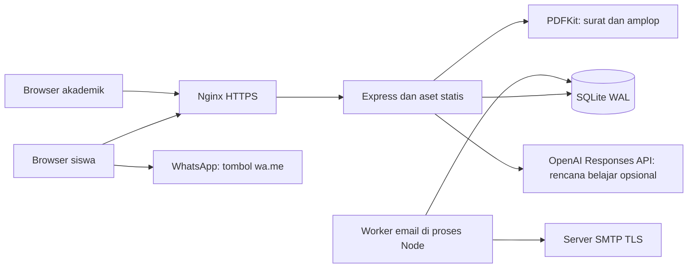
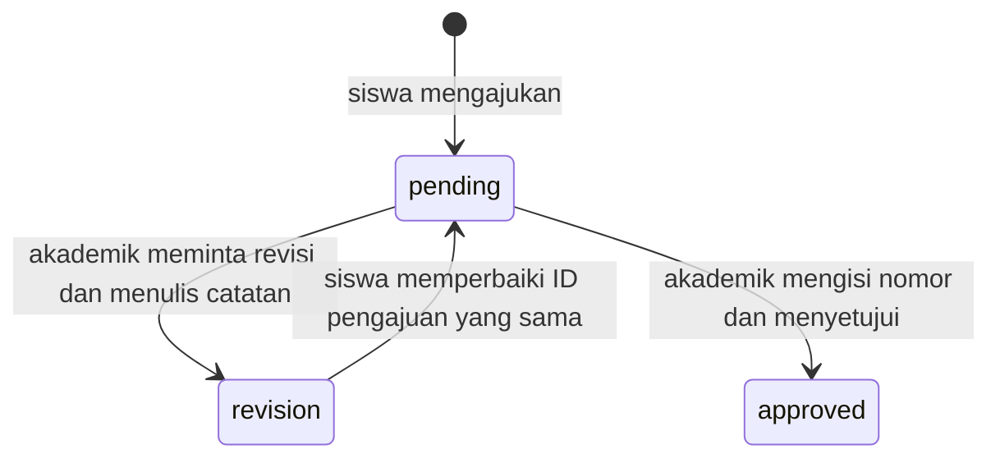

# Arsitektur

## Komponen

Nginx merupakan konfigurasi installer; pengembangan lokal dapat langsung mengakses Express. Tidak ditemukan server frontend terpisah, bundler, message broker, Redis, atau proses worker terpisah.

## Pembagian source

| Modul | Tanggung jawab |
| --- | --- |
| `server.js` | Membuka DB, migrasi, middleware, auth siswa, pengajuan, PDF, file statis, startup worker |
| `branch-migration.js` | Migrasi cabang dan tujuan manual dengan pemeriksaan foreign key |
| `approvals.js` | Skema persetujuan, auth akademik, antrean pemeriksaan, keputusan, audit, link publik |
| `career.js` | Profil siswa, perhitungan rekomendasi, rencana template/API AI, kuota |
| `mail.js` | Konfigurasi SMTP, antrean persisten, lease, retry, status email |
| `public/app.js` | State siswa, form, riwayat, unduhan, polling status |
| `public/academic.js` | Login dan pemeriksaan akademik melalui API terpisah |
| `public/career.js` | Profil keahlian, hasil rekomendasi, persetujuan pengiriman ke AI |
| `public/chatbot.js` | Panduan statis dalam panel berlabel Chatbot AI |

## Alur persetujuan

Tidak ditemukan transisi pembatalan/penghapusan, penolakan terminal, atau pembukaan kembali surat approved. Keputusan memakai transaksi dan pemeriksaan `version`. Email dijadwalkan dalam transaksi yang sama dengan pengajuan/resubmission; kegagalan SMTP terpisah dari keberhasilan penyimpanan pengajuan.

`createApp()` mengembalikan `{ app, db, notifications }`. Worker hanya dimulai pada entrypoint langsung `node server.js`, bukan otomatis saat modul dipakai CLI/tes.

Sumber: [server.js](../../server.js), [approvals.js](../../approvals.js), [career.js](../../career.js), [mail.js](../../mail.js), [installer](../../deploy/install-vps.sh).
