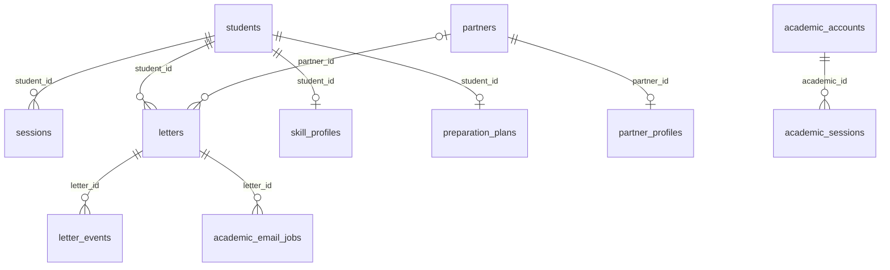

# Struktur Database

SQLite pada `DB_PATH`; default aplikasi `data/app.sqlite`, konfigurasi installer `/var/lib/eduagentpct/app.sqlite`. Skema di bawah berasal dari `createApp()` pada database sementara kosong setelah semua migrasi dijalankan. Tidak membaca database siswa/produksi.

Terdapat **12 tabel**. Foreign key ON, journal WAL, busy_timeout 5.000 ms pada koneksi aplikasi. JSON disimpan sebagai TEXT dan di-parse oleh aplikasi; tidak ada tabel cabang/kategori atau migration ledger terpisah.

## Relasi foreign key aktual

`letters.approved_by`, `letter_events.actor_id`, dan `ai_attempts.student_id` bukan foreign key pada DDL. Jangan menganggap semua kolom bernama ID mempunyai constraint relasional.

## Tabel dan kolom

### academic_accounts

Akun petugas akademik per cabang.

| Kolom | Tipe SQLite | Constraint kolom | Default |
| --- | --- | --- | --- |
| `id` | INTEGER | PK | — |
| `branch` | TEXT | NOT NULL | — |
| `username` | TEXT | NOT NULL | — |
| `name` | TEXT | NOT NULL | — |
| `salt` | TEXT | NOT NULL | — |
| `hash` | TEXT | NOT NULL | — |
| `active` | INTEGER | NOT NULL | `1` |

Indeks/keunikan: UNIQUE (branch, username).

### academic_email_jobs

Antrean notifikasi SMTP per versi pengajuan.

| Kolom | Tipe SQLite | Constraint kolom | Default |
| --- | --- | --- | --- |
| `id` | INTEGER | PK | — |
| `letter_id` | INTEGER | NOT NULL | — |
| `letter_version` | INTEGER | NOT NULL | — |
| `state` | TEXT | NOT NULL | `'queued'` |
| `attempts` | INTEGER | NOT NULL | `0` |
| `next_at` | INTEGER | NOT NULL | `0` |
| `lease_until` | INTEGER | NOT NULL | `0` |
| `lease_token` | TEXT | — | — |
| `last_code` | TEXT | — | — |
| `submitted_at` | TEXT | — | — |

Indeks/keunikan: UNIQUE (letter_id, letter_version).

FK: `letter_id` → `letters.id`. Tidak ada ON DELETE CASCADE yang didefinisikan.

### academic_sessions

Sesi petugas akademik.

| Kolom | Tipe SQLite | Constraint kolom | Default |
| --- | --- | --- | --- |
| `token` | TEXT | PK | — |
| `academic_id` | INTEGER | NOT NULL | — |
| `expires` | INTEGER | NOT NULL | — |

Indeks/keunikan: UNIQUE (token).

FK: `academic_id` → `academic_accounts.id`. Tidak ada ON DELETE CASCADE yang didefinisikan.

### ai_attempts

Jumlah percobaan AI per siswa/hari UTC.

| Kolom | Tipe SQLite | Constraint kolom | Default |
| --- | --- | --- | --- |
| `student_id` | INTEGER | PK posisi 1, NOT NULL | — |
| `day` | TEXT | PK posisi 2, NOT NULL | — |
| `count` | INTEGER | NOT NULL | — |

Indeks/keunikan: UNIQUE (student_id, day).

### letter_events

Audit pengajuan, revisi, pengajuan ulang, persetujuan.

| Kolom | Tipe SQLite | Constraint kolom | Default |
| --- | --- | --- | --- |
| `id` | INTEGER | PK | — |
| `letter_id` | INTEGER | NOT NULL | — |
| `actor_type` | TEXT | NOT NULL | — |
| `actor_id` | INTEGER | NOT NULL | — |
| `actor_name` | TEXT | NOT NULL | — |
| `action` | TEXT | NOT NULL | — |
| `number` | TEXT | — | — |
| `note` | TEXT | NOT NULL | `''` |
| `created` | TEXT | NOT NULL | `CURRENT_TIMESTAMP` |

Tidak ada indeks terpisah yang dilaporkan PRAGMA index_list; INTEGER PRIMARY KEY memakai rowid.

FK: `letter_id` → `letters.id`. Tidak ada ON DELETE CASCADE yang didefinisikan.

### letters

Pengajuan, keputusan, peserta, nomor dan tujuan.

| Kolom | Tipe SQLite | Constraint kolom | Default |
| --- | --- | --- | --- |
| `id` | INTEGER | PK | — |
| `student_id` | INTEGER | NOT NULL | — |
| `number` | TEXT | — | — |
| `partner_id` | INTEGER | — | — |
| `start` | TEXT | NOT NULL | — |
| `end` | TEXT | NOT NULL | — |
| `issued` | TEXT | NOT NULL | — |
| `participants` | TEXT | NOT NULL | — |
| `created` | TEXT | — | `CURRENT_TIMESTAMP` |
| `request_type` | TEXT | NOT NULL | `'PKL'` |
| `category` | TEXT | — | — |
| `branch` | TEXT | NOT NULL | `'Lahat'` |
| `custom_partner_name` | TEXT | — | — |
| `status` | TEXT | NOT NULL | `'pending'` |
| `review_token` | TEXT | — | — |
| `review_note` | TEXT | NOT NULL | `''` |
| `version` | INTEGER | NOT NULL | `1` |
| `approved_by` | INTEGER | — | — |
| `approved_at` | TEXT | — | — |

Indeks/keunikan: UNIQUE (review_token); UNIQUE (branch, number).

FK: `partner_id` → `partners.id`; `student_id` → `students.id`. Tidak ada ON DELETE CASCADE yang didefinisikan.

### partner_profiles

Metadata pekerjaan mitra dalam JSON TEXT.

| Kolom | Tipe SQLite | Constraint kolom | Default |
| --- | --- | --- | --- |
| `partner_id` | INTEGER | PK | — |
| `data` | TEXT | NOT NULL | — |

Tidak ada indeks terpisah yang dilaporkan PRAGMA index_list; INTEGER PRIMARY KEY memakai rowid.

FK: `partner_id` → `partners.id`. Tidak ada ON DELETE CASCADE yang didefinisikan.

### partners

Daftar tujuan mitra per cabang.

| Kolom | Tipe SQLite | Constraint kolom | Default |
| --- | --- | --- | --- |
| `id` | INTEGER | PK | — |
| `name` | TEXT | NOT NULL | — |
| `recipient` | TEXT | NOT NULL | — |
| `branch` | TEXT | NOT NULL | `'Lahat'` |

Tidak ada indeks terpisah yang dilaporkan PRAGMA index_list; INTEGER PRIMARY KEY memakai rowid.

### preparation_plans

Satu rencana terkini per siswa.

| Kolom | Tipe SQLite | Constraint kolom | Default |
| --- | --- | --- | --- |
| `student_id` | INTEGER | PK | — |
| `mode` | TEXT | NOT NULL | — |
| `content` | TEXT | NOT NULL | — |
| `created` | TEXT | NOT NULL | — |

Tidak ada indeks terpisah yang dilaporkan PRAGMA index_list; INTEGER PRIMARY KEY memakai rowid.

FK: `student_id` → `students.id`. Tidak ada ON DELETE CASCADE yang didefinisikan.

### sessions

Sesi siswa, token disimpan sebagai digest.

| Kolom | Tipe SQLite | Constraint kolom | Default |
| --- | --- | --- | --- |
| `token` | TEXT | PK | — |
| `student_id` | INTEGER | NOT NULL | — |
| `expires` | INTEGER | NOT NULL | — |

Indeks/keunikan: UNIQUE (token).

FK: `student_id` → `students.id`. Tidak ada ON DELETE CASCADE yang didefinisikan.

### skill_profiles

Profil keahlian siswa dalam JSON TEXT.

| Kolom | Tipe SQLite | Constraint kolom | Default |
| --- | --- | --- | --- |
| `student_id` | INTEGER | PK | — |
| `data` | TEXT | NOT NULL | — |

Tidak ada indeks terpisah yang dilaporkan PRAGMA index_list; INTEGER PRIMARY KEY memakai rowid.

FK: `student_id` → `students.id`. Tidak ada ON DELETE CASCADE yang didefinisikan.

### students

Identitas/login siswa per cabang.

| Kolom | Tipe SQLite | Constraint kolom | Default |
| --- | --- | --- | --- |
| `id` | INTEGER | PK | — |
| `name` | TEXT | NOT NULL | — |
| `nis` | TEXT | NOT NULL | — |
| `salt` | TEXT | NOT NULL | — |
| `hash` | TEXT | NOT NULL | — |
| `branch` | TEXT | NOT NULL | `'Lahat'` |

Indeks/keunikan: UNIQUE (branch, nis).

## Isi JSON dan arti kolom

- `letters.participants`: array `{name, program}`; tujuan manual ada di `custom_partner_name` dengan `partner_id=NULL`.
- `letters.status`: pending/revision/approved dari aplikasi; `version` meningkat saat keputusan/resubmission; nomor unik `(branch,number)` dan boleh NULL sebelum approval.
- `review_token`: pengenal acak URL yang unik, bukan credential persetujuan. `approved_by` diisi ID akun akademik oleh kode keputusan.
- `skill_profiles.data`: request_type, category, skills, interests, experience, location, portfolio.
- `partner_profiles.data`: categories, request_types, skills, location, description, acceptance, verified; importer dapat mempertahankan metadata tambahan seperti source.
- `preparation_plans.mode`: template atau ai, dengan content/created; menulis profil menghapus rencana sebelumnya.
- `ai_attempts.day`: tanggal UTC; `count` membatasi percobaan, termasuk provider gagal.
- Sesi memakai expiry epoch millisecond. approved_at/submitted_at dan waktu plan memakai ISO dari JavaScript; created pada surat/event default CURRENT_TIMESTAMP SQLite. Jangan menganggap semua format timestamp identik.
- Email job memiliki lease/next_at epoch millisecond; state queued/blocked/sending/retry/failed/submitted/cancelled dipakai oleh kode, bukan CHECK SQL.

## Migrasi

Urutan startup: schema dasar → kolom kategori/jenis → migrateBranches → migrateCustomPartners → initApprovals → mail queue → tabel karier. Migrasi cabang memetakan data lama ke Lahat dan menjaga ID. Migrasi tujuan manual membuat partner_id nullable sambil mempertahankan kolom/indeks/trigger. Helpers melakukan transaksi dan foreign_key_check. Surat lama tanpa status approval menjadi pending; nomor lama dipertahankan untuk ditinjau.

SQL snapshot: [schema.sql](evidence/schema.sql). Skema pada database legacy dapat memiliki detail SQL historis berbeda; ini bukan hasil inspeksi schema VPS.

Sumber: [server.js](../../server.js), [migrasi](../../branch-migration.js), [approval](../../approvals.js), [karier](../../career.js), [email](../../mail.js).
